# Construction Wand


With a Construction Wand you can place multiple blocks (up to 1024) at once, extending your build on the side you're
facing. If that's not enough: you can upgrade your wand with additional cores, allowing you to place a block behind the
block you are facing, conjure blocks in mid air, destroy lots of blocks very fast or replace a whole wall with another
block.

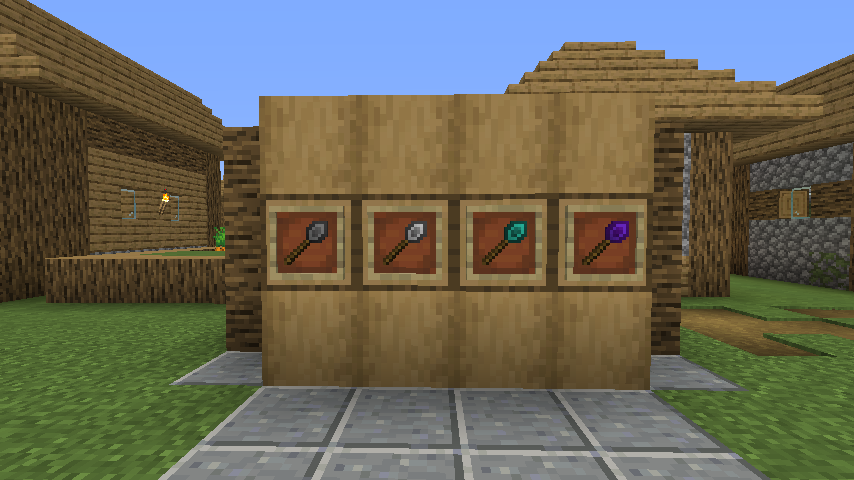

**Note:** These are the instructions for ConstructionWand version 2.0+, which introduced some new features.
If you are still using version 1.x, refer to [those](https://github.com/Theta-Dev/ConstructionWand/tree/1.16.2-1.7)
instructions.

## Wands

There are basic wands made from wood, stone, copper, iron, gold, diamond and netherite, plus the Infinity wand. Wands
from higher tiers are more powerful and last longer. These properties can be changed in the config.

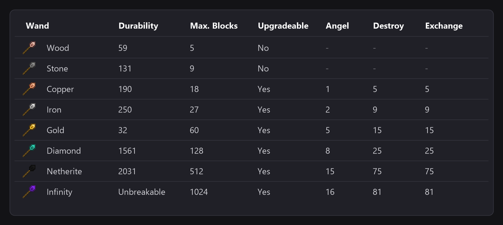

| Wand      | Durability  | Max. Blocks | Upgradeable | Angel distance | Max. Blocks (Destroy) | Max. Blocks (Exchange) |
|-----------|-------------|-------------|-------------|----------------|-----------------------|------------------------|
| Wood      | 59          | 5           | No          | -              | -                     | -                      |
| Stone     | 131         | 9           | No          | -              | -                     | -                      |
| Copper    | 190         | 18          | Yes         | 1              | 5                     | 5                      |
| Iron      | 250         | 27          | Yes         | 2              | 9                     | 9                      |
| Gold      | 32          | 60          | Yes         | 5              | 15                    | 15                     |
| Diamond   | 1561        | 128         | Yes         | 8              | 25                    | 25                     |
| Netherite | 2031        | 512         | Yes         | 15             | 75                    | 75                     |
| Infinity  | Unbreakable | 1024        | Yes         | 16             | 81                    | 81                     |

## Crafting
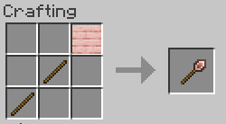
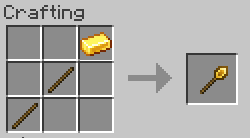
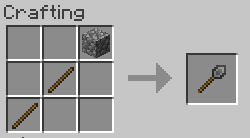
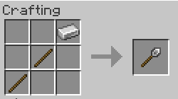
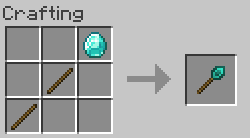
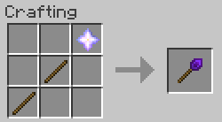
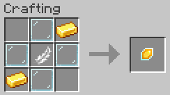
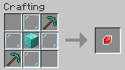

The Copper wand is crafted like the other wands, with copper ingots. Every wand can be enchanted with Silk Touch.

## Keybindings

To change a wand's core and options or undo your placement you need to hold down the wand option key
(refered as OPTKEY). By default, this is CTRL, but it can be changed in the client config file. To prevent unwanted
changes to your options, you can configure that you have to hold down SNEAK as well to change options or open up the
GUI.

Other keys, all of them can be changed in the controls:

- **Undo Wand Action** (K): undoes the last operation without looking at any block
- **Select Exchange Block** (Numpad 7): chooses the block the Exchange core places
- **Toggle Void Sack** (M): activates or deactivates the Void Sack

## Wand cores

Wand cores are magical gemstones that make your wand do its thing. Every core has its own overlay on the wand, so you
can see which one is active.

Every wand comes with a Construction core. You can make your wand even better by putting
aditional cores into it. Put your new core together with your wand in a
crafting grid to install it. To switch between cores, hold down OPTKEY and left click empty space
with your wand.
Stone wands can't be upgraded.

**Construction core**

Extend your build on the side facing you. Maximum number of blocks depends on wand tier.
Hold down OPTKEY and scroll to change placement restriction
(Horizontal, Vertical, North/South, East/West, No lock).

**Angel core**

Place a block on the opposite side of the block (or row of blocks) you are facing. Maximum distance depends
on wand tier. Right click empty space to place a block in midair (similar to angel blocks, hence the name).
To do that, you'll need to have the block you want to place in your offhand. You can't place a block in midair
if you've fallen more than 10 blocks deep (no easy rescue tool from falling into the void).

**Destruction core**

Destroy blocks (no tile entities) on the side facing you. Maximum number of blocks depends on wand tier.
Restrictions work just like with the Construction core.

The drops of the destroyed blocks go to your inventory, or into an active Void Sack. In creative mode, and without a
Void Sack, the blocks are simply destroyed. If you don't want the drops in survival either, set
`DestructionGivesDrops` to false in the server config. If the wand is enchanted with Silk Touch, the blocks are broken
as a Silk Touch tool would break them. You can use the undo feature if you've made a mistake.

**Exchange core**

Replace the blocks on the side facing you (or a row of blocks) with another block. To choose the block, look at it with
the Exchange core active and press the Select Exchange Block key (Numpad 7 by default). Maximum number of blocks
depends on wand tier.

## Energy Upgrade

The Energy Upgrade makes a wand run on energy instead of durability. Put it together with the wand in a crafting grid,
like a core (it is crafted with 8 copper ingots around a block of redstone). A wand with the upgrade stores up to
100000 FE, every block costs 100 FE (`EnergyCapacity` and `EnergyPerBlock` in the server config) and the item bar shows
the charge. The Infinity wand does not take it.

The wand can be charged with any charger or cable that speaks FE or Team Reborn Energy, and in the AE2 Charger when
Applied Energistics 2 is installed.

## Void Sack

The Void Sack catches the items the Destruction core breaks (and the ones you pick up) and keeps them in its internal
inventory or in a container you link to it. Press the toggle key (M by default) to activate it.

## Options
SNEAK+OPTKEY+Right clicking empty space opens the option screen of your wand.

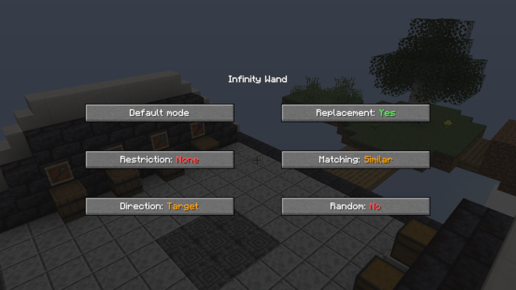

**Restriction:** If restriction is enabled the wand will only place blocks in one row or column
(choose between North/South, East/West on a horizontal plane and Horizontal, Vertical on a vertical plane).
If the direction lock is switched off, the wand will extend the entire face of the building it's pointed at. This option
has no effect if the angel core is enabled.

**Direction:** If set to "Player" the wand places blocks in the same direction as if they were placed by yourself.
Target mode places the blocks in the same direction as their supporting block. See the picture below:

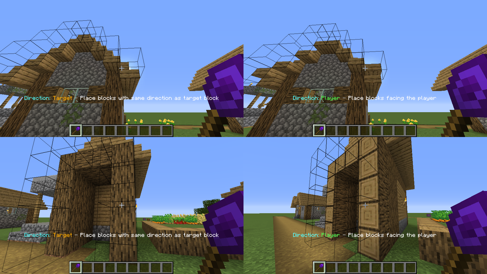

**Replacement:** Enables/disables the replacement of replaceable blocks (Fluids, snow, tallgrass).

**Matching:** Select which blocks are extended by the wand. If set to "EXACT" it will only extend blocks that
are exactly the same as the selected block.<br>
"SIMILAR" will treat similar blocks equally (e.g. extend dirt and grass blocks).<br>
"ANY" will extend any block on the face of the building you're looking at.

**Random:** If random mode is enabled, the wand places random blocks from your hotbar.<br>
~~Shamelessly stolen~~ Inspired by the Trowel from Quark.

## Undo

The wand remembers your last operations (3 by default, it can be changed in the server config) and you can undo them in
two ways:

- Hold down Sneak+OPTKEY while looking at the blocks. The last blocks you placed show up with a green border.
  Sneak+OPTKEY+Right clicking any of them undoes the operation.
- Press the Undo Wand Action key (K by default) while holding a wand. It undoes the last operation without having to
  look at any block.

What an undo does depends on the core:

- **Construction and Angel core:** the blocks are removed and you get all the items back.
- **Destruction core:** the blocks come back and the items the core gave you are taken back from your inventory, so you
  can only undo it while you still carry them. If the drops went into a Void Sack, that destruction can't be undone. If
  the core destroyed without drops (creative mode or `DestructionGivesDrops` off), the blocks simply come back.
- **Exchange core:** the original blocks are restored and you get back the blocks it used.

## Additional features

- Shulker boxes, bundles and many containers from other mods can provide building blocks for the wand

- Botania compatibility: The Black Hole Talisman can supply blocks just like shulker boxes can. Having a Rod of the
  Lands / Rod of the Depths in your inventory will provide you with infinite dirt/cobble at the cost of Mana.

- Having blocks in your offhand will place them instead of the block you're looking at

- Look at your statisics to see how many blocks you have placed using your wand

- The Infinity Wand won't burn in lava just like netherite gear.

- Ingame documentation with Just Enough Items (JEI)

## TileEntity Blacklist

Some modded TileEntitys can cause issues when placed using a wand. They may turn into invisible and
unremovable ghost blocks, become unbreakable or cause other unwanted effects.

That's why I've included a Black/Whitelist system
for TileEntities in CW Version 1.7. Chisels&Bits blocks are blacklisted by default.
There are probably a few other tile entities from other mods out there which may cause issues as well.
If you find some of them you can tell me by creating
an issue, commenting on Curse or editing the default blacklist yourself
(it is located at https://github.com/Theta-Dev/ConstructionWand/blob/1.19/src/main/java/thetadev/constructionwand/basics/ConfigServer.java#L25)
and making a PR.

## Contributions and #Hacktoberfest

As #Hacktoberfest now requires repo owners to opt in, I added the tag to this repository.

I'd really appreciate translations. Currently, ConstructionWand is available in English, German, Swedish And Spanish.
If you speak any other language you can help translate the mod and add a new language file
under `src/main/resources/assets/constructionwand/lang/`.

## Building

Minecraft 1.21.1 for NeoForge and Fabric, laid out like the
[MultiLoader template](https://github.com/jaredlll08/MultiLoader-Template): the code shared by both loaders is in
`common/`, the loader specific code in `neoforge/` and `fabric/`. Gradle needs JDK 21; the matching Java toolchain is
picked automatically.

```
./gradlew build                          # both loaders
./gradlew :neoforge:build                # a single loader
./gradlew :neoforge:runClient            # NeoForge client (runServer for a server)
./gradlew :fabric:runClient              # Fabric client (runServer for a server)
```

Dependency versions are declared in `gradle.properties` (shared), `neoforge/gradle.properties` and
`fabric/gradle.properties`. The generated recipes, advancements, models and language files are in
`common/src/generated/resources`. Recipe viewers (JEI, REI, EMI) and the storage integrations (AE2, Refined Storage,
Sophisticated Backpacks, Curios) are only built for the loaders they exist for.

Other Minecraft versions live in the `multiloader/<version>` branches.
